# Poly Haven: Concrete textures

**44 assets from [Poly Haven](https://polyhaven.com), dedicated to the public domain under [CC0](https://polyhaven.com/license).** Use them in any game, free or paid, and change them however you like; no credit is needed.

PBR textures as 1K and 2K JPG maps (colour, normal (GL and DX), roughness, AO, displacement and more). 873.5 MB in all.

This is a copy kept by [zuujis-cc0](https://github.com/zuujis-cc0) so game makers can take single files from GitHub. It is not made by or affiliated with Poly Haven: the originals, often in more formats and higher resolutions, are on [polyhaven.com](https://polyhaven.com). If they help you, consider [supporting Poly Haven](https://www.patreon.com/polyhaven/overview).

Every file is listed in [MANIFEST.tsv](MANIFEST.tsv) with its size and SHA-256. More free assets: [the Zuujis collection](https://github.com/zuujis-cc0/free-game-assets#readme).

| | | | |
| :-: | :-: | :-: | :-: |
| <a href="anti_slip_concrete">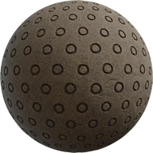</a> <b><a href="anti_slip_concrete">Anti Slip Concrete</a></b> by Charlotte Baglioni · <a href="https://polyhaven.com/a/anti_slip_concrete">source</a> | <a href="asbestos_sheet">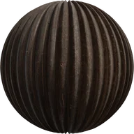</a> <b><a href="asbestos_sheet">Asbestos Sheet</a></b> by Amal Kumar · <a href="https://polyhaven.com/a/asbestos_sheet">source</a> | <a href="asbestos_sheet_02">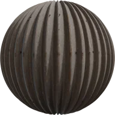</a> <b><a href="asbestos_sheet_02">Asbestos Sheet 02</a></b> by Amal Kumar · <a href="https://polyhaven.com/a/asbestos_sheet_02">source</a> | <a href="beige_wall_001">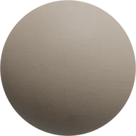</a> <b><a href="beige_wall_001">Beige Wall 001</a></b> by Dimitrios Savva, Rico Cilliers · <a href="https://polyhaven.com/a/beige_wall_001">source</a> |
| <a href="beige_wall_002">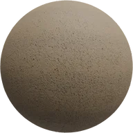</a> <b><a href="beige_wall_002">Beige Wall 002</a></b> by Dimitrios Savva, Rico Cilliers · <a href="https://polyhaven.com/a/beige_wall_002">source</a> | <a href="blue_plaster_wall">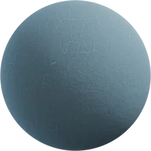</a> <b><a href="blue_plaster_wall">Blue Plaster Wall</a></b> by Dimitrios Savva · <a href="https://polyhaven.com/a/blue_plaster_wall">source</a> | <a href="blue_plaster_weathered">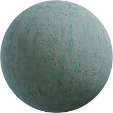</a> <b><a href="blue_plaster_weathered">Blue Plaster Weathered</a></b> by Amal Kumar · <a href="https://polyhaven.com/a/blue_plaster_weathered">source</a> | <a href="brushed_concrete">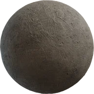</a> <b><a href="brushed_concrete">Brushed Concrete </a></b> by Dario Barresi, Dimitrios Savva · <a href="https://polyhaven.com/a/brushed_concrete">source</a> |
| <a href="brushed_concrete_03">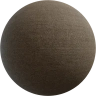</a> <b><a href="brushed_concrete_03">Brushed Concrete 03</a></b> by Amal Kumar · <a href="https://polyhaven.com/a/brushed_concrete_03">source</a> | <a href="brushed_concrete_04">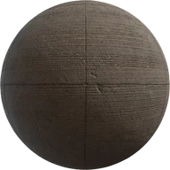</a> <b><a href="brushed_concrete_04">Brushed Concrete 04</a></b> by Amal Kumar · <a href="https://polyhaven.com/a/brushed_concrete_04">source</a> | <a href="brushed_concrete_2">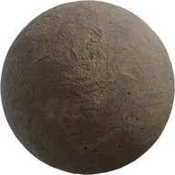</a> <b><a href="brushed_concrete_2">Brushed Concrete 2</a></b> by Dario Barresi, Dimitrios Savva · <a href="https://polyhaven.com/a/brushed_concrete_2">source</a> | <a href="ceiling_interior">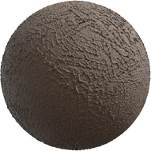</a> <b><a href="ceiling_interior">Ceiling Interior</a></b> by Dimitrios Savva · <a href="https://polyhaven.com/a/ceiling_interior">source</a> |
| <a href="chipped_concrete">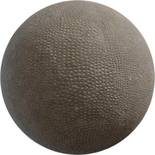</a> <b><a href="chipped_concrete">Chipped Concrete</a></b> by Amal Kumar · <a href="https://polyhaven.com/a/chipped_concrete">source</a> | <a href="clay_floor_001">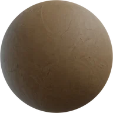</a> <b><a href="clay_floor_001">Clay Floor 001</a></b> by Dimitrios Savva, Rico Cilliers · <a href="https://polyhaven.com/a/clay_floor_001">source</a> | <a href="clay_plaster">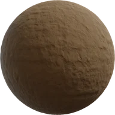</a> <b><a href="clay_plaster">Clay Plaster</a></b> by Amal Kumar · <a href="https://polyhaven.com/a/clay_plaster">source</a> | <a href="climbing_wall">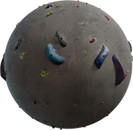</a> <b><a href="climbing_wall">Climbing Wall</a></b> by Dimitrios Savva · <a href="https://polyhaven.com/a/climbing_wall">source</a> |
| <a href="climbing_wall_02">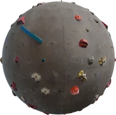</a> <b><a href="climbing_wall_02">Climbing Wall 02</a></b> by Dimitrios Savva · <a href="https://polyhaven.com/a/climbing_wall_02">source</a> | <a href="climbing_wall_base">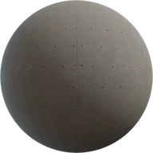</a> <b><a href="climbing_wall_base">Climbing Wall Base</a></b> by Dimitrios Savva · <a href="https://polyhaven.com/a/climbing_wall_base">source</a> | <a href="concrete">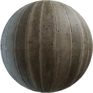</a> <b><a href="concrete">Concrete</a></b> by Rob Tuytel · <a href="https://polyhaven.com/a/concrete">source</a> | <a href="concrete_debris">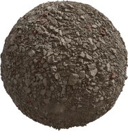</a> <b><a href="concrete_debris">Concrete Debris</a></b> by Amal Kumar · <a href="https://polyhaven.com/a/concrete_debris">source</a> |
| <a href="concrete_floor">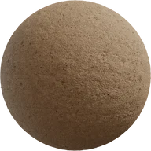</a> <b><a href="concrete_floor">Concrete Floor</a></b> by eye-candy.xyz · <a href="https://polyhaven.com/a/concrete_floor">source</a> | <a href="concrete_floor_01">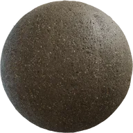</a> <b><a href="concrete_floor_01">Concrete Floor 01</a></b> by Rob Tuytel · <a href="https://polyhaven.com/a/concrete_floor_01">source</a> | <a href="concrete_floor_02">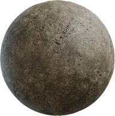</a> <b><a href="concrete_floor_02">Concrete Floor 02</a></b> by Rob Tuytel · <a href="https://polyhaven.com/a/concrete_floor_02">source</a> | <a href="concrete_floor_03">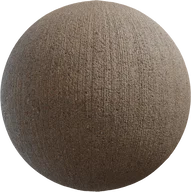</a> <b><a href="concrete_floor_03">Concrete Floor 03</a></b> by Matterfield, Rob Tuytel · <a href="https://polyhaven.com/a/concrete_floor_03">source</a> |
| <a href="concrete_floor_damaged_01">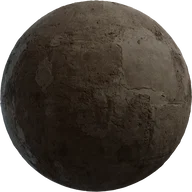</a> <b><a href="concrete_floor_damaged_01">Concrete Floor Damaged 01</a></b> by Rob Tuytel · <a href="https://polyhaven.com/a/concrete_floor_damaged_01">source</a> | <a href="concrete_floor_painted">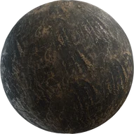</a> <b><a href="concrete_floor_painted">Concrete Floor Painted</a></b> by Rob Tuytel · <a href="https://polyhaven.com/a/concrete_floor_painted">source</a> | <a href="concrete_floor_worn_001">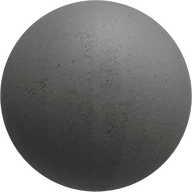</a> <b><a href="concrete_floor_worn_001">Concrete Floor Worn 001</a></b> by Dimitrios Savva, Rico Cilliers · <a href="https://polyhaven.com/a/concrete_floor_worn_001">source</a> | <a href="concrete_floor_worn_02">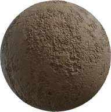</a> <b><a href="concrete_floor_worn_02">Concrete Floor Worn 02</a></b> by Dimitrios Savva · <a href="https://polyhaven.com/a/concrete_floor_worn_02">source</a> |
| <a href="concrete_layers">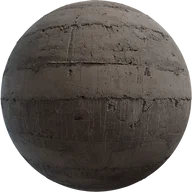</a> <b><a href="concrete_layers">Concrete Layers</a></b> by Amal Kumar · <a href="https://polyhaven.com/a/concrete_layers">source</a> | <a href="concrete_layers_02">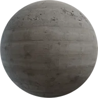</a> <b><a href="concrete_layers_02">Concrete Layers 02</a></b> by Rob Tuytel · <a href="https://polyhaven.com/a/concrete_layers_02">source</a> | <a href="concrete_moss">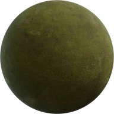</a> <b><a href="concrete_moss">Concrete Moss</a></b> by Rob Tuytel · <a href="https://polyhaven.com/a/concrete_moss">source</a> | <a href="concrete_slab_wall">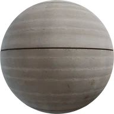</a> <b><a href="concrete_slab_wall">Concrete Slab Wall</a></b> by Dimitrios Savva · <a href="https://polyhaven.com/a/concrete_slab_wall">source</a> |
| <a href="concrete_slab_wall_02">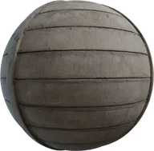</a> <b><a href="concrete_slab_wall_02">Concrete Slab Wall 02</a></b> by Amal Kumar · <a href="https://polyhaven.com/a/concrete_slab_wall_02">source</a> | <a href="concrete_wall_001">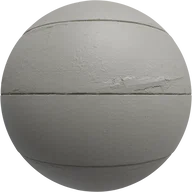</a> <b><a href="concrete_wall_001">Concrete Wall 001</a></b> by Dimitrios Savva, Rico Cilliers · <a href="https://polyhaven.com/a/concrete_wall_001">source</a> | <a href="concrete_wall_003">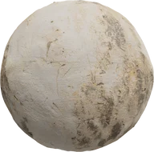</a> <b><a href="concrete_wall_003">Concrete Wall 003</a></b> by Dimitrios Savva, Rico Cilliers · <a href="https://polyhaven.com/a/concrete_wall_003">source</a> | <a href="concrete_wall_004">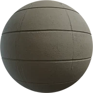</a> <b><a href="concrete_wall_004">Concrete Wall 004</a></b> by Charlotte Baglioni, Dario Barresi · <a href="https://polyhaven.com/a/concrete_wall_004">source</a> |
| <a href="concrete_wall_005">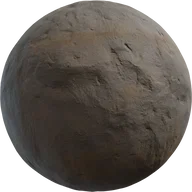</a> <b><a href="concrete_wall_005">Concrete Wall 005</a></b> by Dario Barresi, Dimitrios Savva · <a href="https://polyhaven.com/a/concrete_wall_005">source</a> | <a href="concrete_wall_006">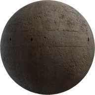</a> <b><a href="concrete_wall_006">Concrete Wall 006</a></b> by Charlotte Baglioni, Dario Barresi · <a href="https://polyhaven.com/a/concrete_wall_006">source</a> | <a href="concrete_wall_007">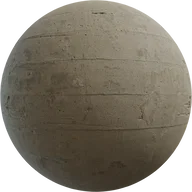</a> <b><a href="concrete_wall_007">Concrete Wall 007</a></b> by Charlotte Baglioni, Dario Barresi, Rico Cilliers · <a href="https://polyhaven.com/a/concrete_wall_007">source</a> | <a href="concrete_wall_008">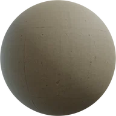</a> <b><a href="concrete_wall_008">Concrete Wall 008</a></b> by Charlotte Baglioni, Dario Barresi · <a href="https://polyhaven.com/a/concrete_wall_008">source</a> |
| <a href="concrete_wall_009">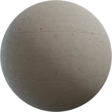</a> <b><a href="concrete_wall_009">Concrete Wall 009</a></b> by Charlotte Baglioni · <a href="https://polyhaven.com/a/concrete_wall_009">source</a> | <a href="coral_fort_wall_01">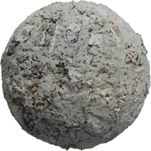</a> <b><a href="coral_fort_wall_01">Coral Fort Wall 01</a></b> by Dimitrios Savva, Rico Cilliers · <a href="https://polyhaven.com/a/coral_fort_wall_01">source</a> | <a href="coral_fort_wall_02">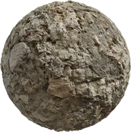</a> <b><a href="coral_fort_wall_02">Coral Fort Wall 02</a></b> by Dimitrios Savva · <a href="https://polyhaven.com/a/coral_fort_wall_02">source</a> | <a href="cracked_concrete">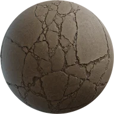</a> <b><a href="cracked_concrete">Cracked Concrete</a></b> by Dimitrios Savva · <a href="https://polyhaven.com/a/cracked_concrete">source</a> |

---

Kept up to date by this repository's own [update workflow](.github/workflows/update.yml), with code and plan from [cc0-mirror](https://github.com/zuujis-cc0/cc0-mirror). Something wrong? [Open an issue there](https://github.com/zuujis-cc0/cc0-mirror/issues/new) or use the [private report form](https://games.zuujis.com/report).
